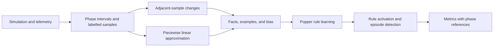
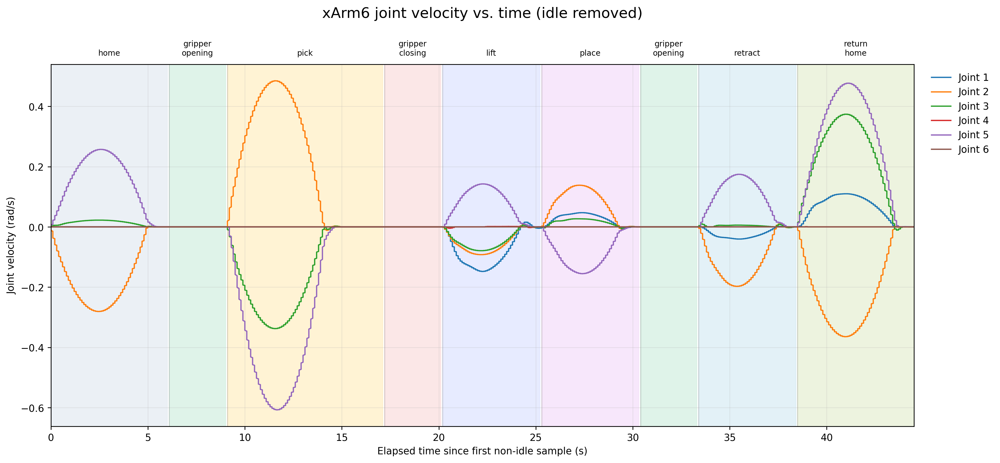

# Qualitative Analysis of Robotic Signal Components Using Inductive Logic Programming

This project studies whether qualitative descriptions of xArm6 pick-and-place telemetry yield more interpretable phase rules in Popper, and how the resulting rules differ in classification and phase-boundary detection. It compares adjacent-sample changes in recorded signals with trends from piecewise linear approximation (PLA). In both representations, the learner receives symbolic facts about signal changes.

## Research questions

- Which joint and gripper trends distinguish the recorded motion phases?
- How do adjacent-sample and PLA representations differ in rule size, training scores, and the timing of rule activations?
- How well do previously learned rules detect phases in a new recording with independently annotated boundaries? The repository includes an evaluator for this question. The saved unlabelled run documents rule activations and candidate episodes.

## Experimental platform and method

The xArm6 simulation targets Ubuntu 22.04, ROS 2 Humble, and Gazebo Classic 11. A recording can include joint position and velocity, gripper position and velocity, and effort where available. The standard Gazebo telemetry used by the packaged simulator leaves effort fields empty. Its motion-test scene has no grasp or contact model. The sequence is home, open gripper, pick, close gripper, lift, place, open gripper, retract, and return home. The two opening occurrences share a phase name and have distinct occurrence IDs. A separate Franka Panda workflow uses recorded HDF5 demonstrations and inferred phase labels.



## Repository structure

```text
├── docs/              Workflow, provenance, and reproduction notes
├── xarm6_simulation/  ROS 2 package, offline tests, and a sample recording
├── scripts/          xArm collection, preprocessing, and per-joint analysis
├── data/
│   ├── raw/          xArm recordings and six-placement CSVs
│   └── processed/    Per-joint CSV exports
├── Pipeline/         Phase-aligned PLA and evaluation scripts with inputs
├── Popper_Test/      Learning tasks, runners, and captured hypotheses
├── results/              Saved outputs from the xArm workflows
│   ├── OLD/          Historical xArm PLA and effort analysis
│   └── comparisons/  Saved xArm6 raw-versus-PLA tables and figures
├── Check_motion/     Command-line checker with fixed phase rules
├── Checking_motion/  Other fixed-rule variants and their saved outputs
├── FrankaReplay/     Franka replay, segmentation, and PLA
├── archive/          Standalone full-motion PLA trials
└── Popper/           Pinned Git submodule
```

## Installation and reproduction

From the repository root in Bash, install the offline analysis dependencies in a Python environment and initialize the learner checkout.

```bash
git submodule update --init Popper
python3 -m venv .venv
source .venv/bin/activate
python -m pip install -r requirements-analysis.txt
```

Learning requires the pinned [Popper environment](Popper/README.md), including its supported Python, `uv`, and SWI-Prolog. ROS 2 uses its own sourced system environment. Franka replay has separate dependencies and a Git LFS dataset. See the [Franka setup](FrankaReplay/README.md).

1. Build and run the xArm6 simulator using the [ROS 2 setup and recording commands](xarm6_simulation/README.md).
2. Use the resulting labelled CSV or start with a [checked-in recording](docs/reproduction.md#phase-labelled-telemetry). The simulator assigns phases from recorded events.
3. Run [phase-aligned PLA and generate the two Popper task sets](docs/reproduction.md#generate-raw-and-pla-tasks).
4. Run [raw and PLA learning](docs/reproduction.md#learn-rules) with fresh output directories.
5. [Evaluate and compare the learned rules](docs/reproduction.md#evaluate-and-compare-rules) on shared telemetry. Supply phase annotations to calculate classification and episode-boundary metrics.

The [workflow guide](docs/reproduction.md) distinguishes commands exercised during cleanup from those that require the target ROS 2 or Popper environment. The [experiment index](Popper_Test/README.md) covers separate historical configurations.

## Recorded results

The table gives means across the 80 saved training rows per representation, with equal weight per run and phase. Classification metrics were recomputed from the confusion counts. Hypothesis size comes from the saved `size` field. The tasks use different example units and signal sets, which limits attribution of the differences to PLA. [Raw runs](results/comparisons/xarm6/all_results_raw.csv) · [PLA runs](results/comparisons/xarm6/all_results_pla.csv)

| Metric | Raw next-step | PLA |
| --- | ---: | ---: |
| Precision | 0.978 | 0.983 |
| Recall | 0.794 | 0.738 |
| F1-score | 0.870 | 0.841 |
| Matthews correlation coefficient | 0.832 | 0.796 |
| Balanced accuracy | 0.892 | 0.865 |
| Mean hypothesis size | 10.175 | 2.750 |

The historical figures summarize an earlier aggregation whose exact protocol still needs to be established. [Classification figure](results/comparisons/xarm6/classification_metrics_comparison.png) · [Complexity figure](results/comparisons/xarm6/complexity_stability_comparison.png) · [Boundary table](results/comparisons/xarm6/raw_vs_pla_boundary_errors.csv) · [Provenance notes](docs/reproduction.md#interpreting-saved-results)



## Project status

The repository preserves recorded telemetry, prepared Popper tasks, repeated-run logs, and historical comparisons. The active research question is whether the observed differences persist on whole held-out recordings with matching channels, phase annotations, and scoring units. Repeated learning on a single set of examples provides evidence about run-to-run variation.

## References

- Andrew Cropper and Rolf Morel. *Learning programs by learning from failures*. Machine Learning 110, 801–856 (2021). [Journal article](https://doi.org/10.1007/s10994-020-05934-z)
- UFACTORY. ROS 2 developer packages for the xArm platform. [Vendor source](https://github.com/xArm-Developer/xarm_ros2)
