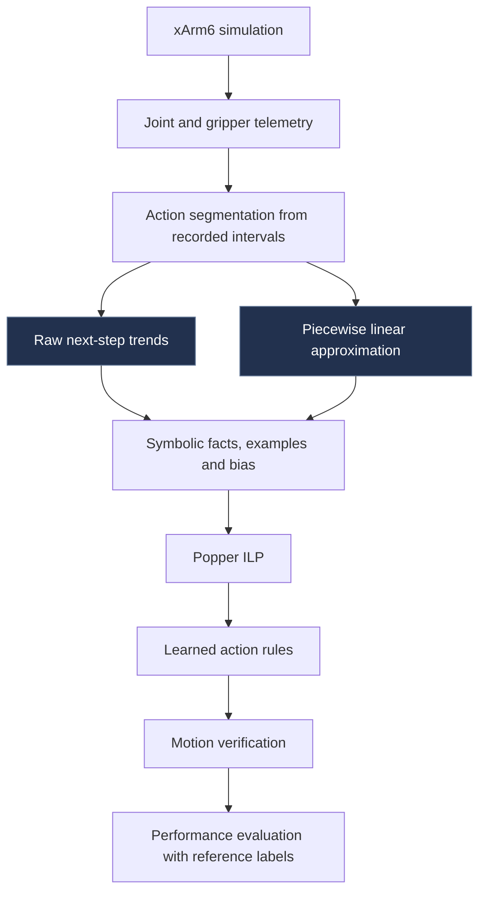
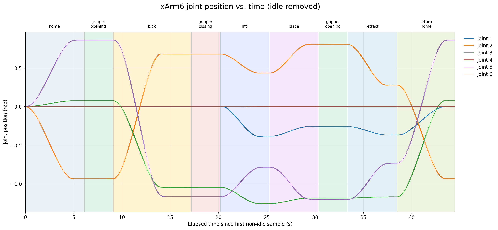
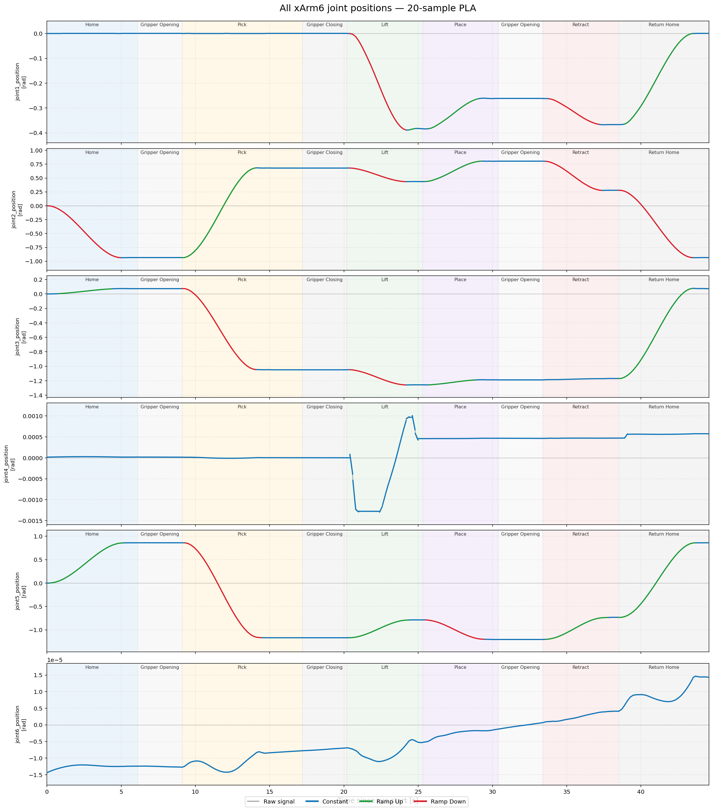
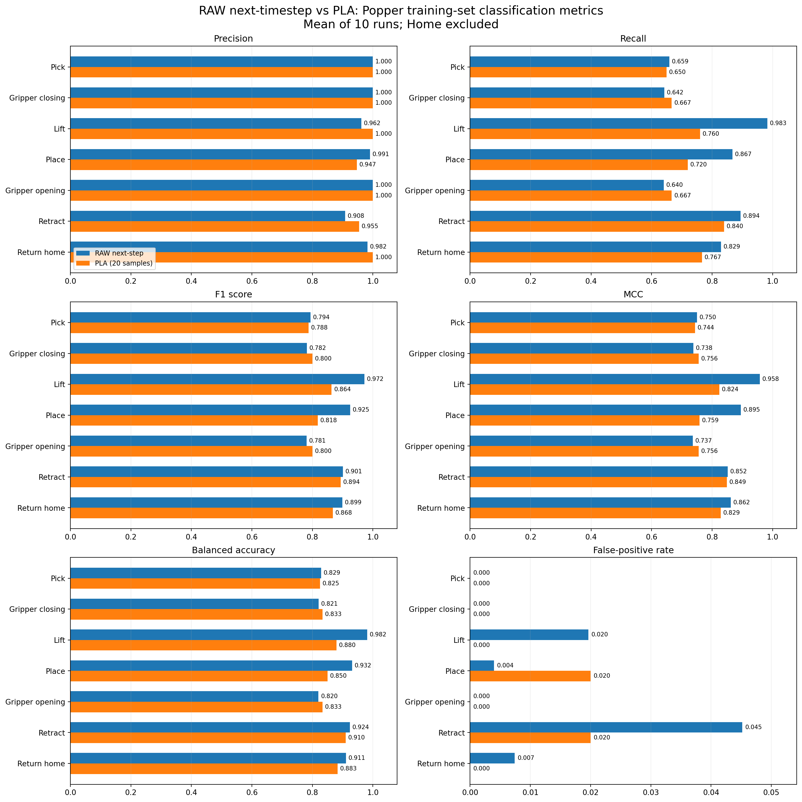
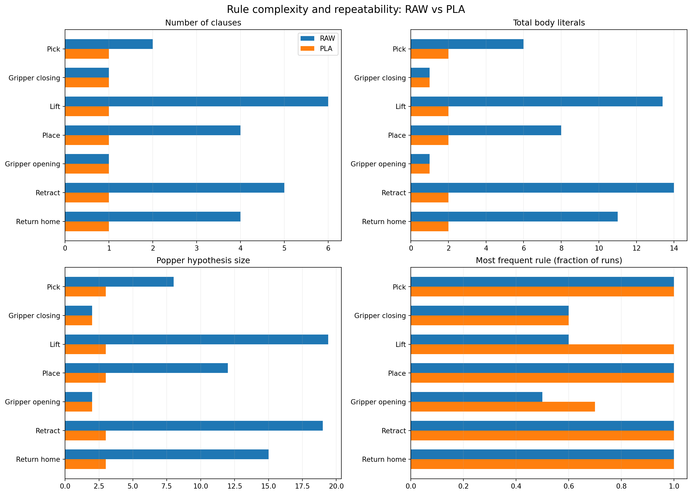

<h1 align="center">Qualitative Analysis of Robotic Signal Components Using Inductive Logic Programming</h1>

<p align="center">Learning interpretable pick-and-place rules from xArm6 telemetry with Popper</p>

<p align="center">
  
  
  
  
</p>

## Research overview

A pick-and-place recording contains continuous, multichannel traces. This project converts those traces into symbolic trends such as *joint 5 position decreases*, so an inductive logic programming (ILP) system can learn which combinations characterize an action. Popper searches for Prolog clauses that cover examples of the target phase while limiting coverage of examples from other phases.

The xArm6 experiments compare trends from **adjacent-sample differences** with trends from **piecewise linear approximation (PLA)**. Across the saved training runs, raw next-step features had a higher mean F1 score (0.870 vs. 0.841). PLA produced smaller hypotheses (mean size 2.750 vs. 10.175) and slightly higher precision. These results characterize the fitted rules on the saved training examples.

## Quick navigation

[Research objectives](#research-objectives) · [Methodology](#methodology) · [Experimental setup](#experimental-setup) · [Popper rules](#learned-logical-rules-for-xarm6-actions) · [Results](#experimental-results) · [Raw vs. PLA](#raw-vs-pla-comparison) · [Reproduction](#installation-and-reproduction) · [Repository structure](#repository-structure) · [Limitations](#limitations-and-future-work) · [References](#references)

## Research objectives

- Identify joint and gripper trends that distinguish phases of an xArm6 pick-and-place sequence.
- Compare raw next-step and PLA representations by training classification, hypothesis complexity, and rule repeatability.
- Evaluate how learned rules activate over a complete recording and measure boundary error where reference intervals are available.

## Methodology



## Experimental setup

The packaged simulator targets Ubuntu 22.04, ROS 2 Humble, and Gazebo Classic 11. It records position and velocity for the six arm joints and the gripper mechanism. Effort fields are available in some recordings and remain empty in exports from the packaged Gazebo joint-state publisher. The packaged scene is a zero-gravity motion test without an object or a grasp/contact model. [Simulation guide](xarm6_simulation/README.md) · [Motion configuration](xarm6_simulation/src/xarm6_pick_place_sim/config/motion.yaml)

Recorded phase events define the labelled intervals. The packaged cycle runs **Home → Gripper opening → Pick → Gripper closing → Lift → Place → Gripper opening → Retract → Return home**. The two opening steps share a target label and have distinct occurrence IDs. The paired learning experiments use the November recording, separate from the sample shipped with the simulation package. [November training telemetry](Pipeline/full_motion_joint_states%2820261111-191003%29.csv) · [Packaged phase timestamps](xarm6_simulation/pick_place_sim_20261028_212105_162803/csv/phase_timestamps.csv)



## Qualitative signal processing

| Representation | Example unit | Trend thresholds |
| --- | --- | --- |
| Raw next-step | Two adjacent samples within the same phase occurrence and cycle | 0.0001 for position and velocity, 0.001 for effort, in the corresponding signal units per sample difference |
| PLA | A non-overlapping, phase-aligned window of 20 samples | 0.002 for fitted position change and 0.01 for fitted velocity change across the window |

A change above the positive threshold becomes `increases`, a change below the negative threshold becomes `decreases`, and values within the thresholds become `constant`. The PLA task builder reads the reconstructed trend columns and selects the most frequent trend per signal when there is a clear winner. A terminal window needs at least 80% of the expected sample count. [Raw task settings](Popper_Test/xarm6_raw_nextstep_popper_10runs/README.md) · [PLA task settings](Popper_Test/xarm6_pla_noisy_popper_10runs/README.md) · [PLA implementation](Pipeline/create_pla_window20_combined.py)

<details>
<summary>View the saved PLA fits for the arm joints</summary>



</details>

## Learned Logical Rules for xArm6 Actions

These are the most frequent saved hypotheses for seven targets in the **xArm6 PLA noisy Popper experiment**, with whitespace adjusted for readability. Each clause predicts its target when every condition holds for the same window `V0`. [Saved PLA hypotheses](Popper_Test/xarm6_pla_noisy_popper_10runs/generated_pla_3states/repeated_runs/merged_hypotheses.md) · [Saved raw hypotheses](Popper_Test/xarm6_raw_nextstep_popper_10runs/generated_raw_nextstep/repeated_runs/merged_hypotheses.md) · [Experiment index](Popper_Test/README.md)

```prolog
pick(V0) :-
    joint1_position_constant(V0), joint5_position_decreases(V0).
gripper_closing(V0) :-
    right_finger_joint_position_increases(V0).
lift(V0) :-
    joint2_position_decreases(V0), joint3_position_decreases(V0).
place(V0) :-
    joint2_position_increases(V0), joint3_velocity_constant(V0).
gripper_opening(V0) :-
    left_finger_joint_position_decreases(V0).
retract_phase(V0) :-
    joint3_position_constant(V0), joint5_position_increases(V0).
return_home(V0) :-
    joint1_position_increases(V0), joint2_position_decreases(V0).
```

The pick and lift clauses combine arm position trends. The gripper clauses use one finger-position trend each. The place clause pairs an increasing joint 2 position with nearly constant joint 3 velocity, which can occur during motion. The retract and return-home clauses both use an increasing position trend, on joint 5 and joint 1 respectively, with different conditions on the other joints.

<details>
<summary>How to read a Popper task</summary>

- `bk.pl` holds symbolic facts about the input examples.
- `exs.pl` defines positive and negative examples for the target phase.
- `bias.pl` declares the target predicate, candidate body predicates, and search bounds.

The paired experiments use one-versus-rest learning in noisy mode. A clause has an action predicate as its head and signal predicates as its conditions. Where a hypothesis has several clauses for the same action, any matching clause can predict that action. [Example PLA pick task](Popper_Test/xarm6_pla_noisy_popper_10runs/generated_pla_3states/pick/)

</details>

## Experimental results

### Raw vs. PLA comparison

Each column averages **80 training rows** with equal weight across 10 runs and eight targets, including Home. Classification metrics use the saved confusion counts. Hypothesis size uses the saved Popper `size` field. [Raw run CSV](results/comparisons/xarm6/all_results_raw.csv) · [PLA run CSV](results/comparisons/xarm6/all_results_pla.csv)

| Metric | Raw next-step | PLA |
| --- | ---: | ---: |
| Precision | 0.978 | **0.983** |
| Recall | **0.794** | 0.738 |
| F1-score | **0.870** | 0.841 |
| Matthews correlation coefficient (MCC) | **0.832** | 0.796 |
| Balanced accuracy | **0.892** | 0.865 |
| Mean hypothesis size ↓ | 10.175 | **2.750** |

The saved classification figure displays seven phases and excludes Home. Raw had higher F1 in five of those phases. PLA had higher F1 for gripper closing and opening. [Historical classification table](results/comparisons/xarm6/raw_vs_pla_classification_metrics.csv)



### Rule complexity and repeatability

A **clause** is one sufficient set of conditions for an action. **Body literals** are the conditions within clauses. In the saved size measure, each clause head and each body literal contribute one unit. **Repeatability** is the fraction of runs that returned the most frequent canonical hypothesis for a phase.

The historical complexity summary reports the means below for the seven phases shown in the comparison figure. Shorter hypotheses give readers fewer conditions to inspect. Out-of-sample performance requires a separate evaluation. [Historical complexity table](results/comparisons/xarm6/raw_vs_pla_complexity_metrics.csv)

| Complexity measure | Raw next-step | PLA |
| --- | ---: | ---: |
| Mean clauses | 3.29 | **1.00** |
| Mean body literals | 7.77 | **1.71** |



### Phase boundaries

The historical table reports lower boundary error for raw in six of seven phases and for PLA in gripper closing. The exact scoring protocol still needs verification. [Phase timeline (PDF)](results/comparisons/xarm6/phase_timeline.pdf) · [Boundary error table](results/comparisons/xarm6/raw_vs_pla_boundary_errors.csv) · [Results provenance](docs/reproduction.md#interpreting-saved-results)

## Whole-motion verification

The paired evaluator applies saved Popper hypotheses to telemetry, groups sustained activations into episodes, and proposes a sequence by selecting the earliest eligible non-overlapping episode for each action. Missing phases are flagged. Its sequence starts at Pick, so the initial Home and gripper opening are outside this check. [Evaluator script](Pipeline/xarm6_unlabelled_rule_evaluator_updated/compare_unlabelled.py) · [Evaluator guide](Pipeline/xarm6_unlabelled_rule_evaluator_updated/README.md)

**Pick → Gripper closing → Lift → Place → Gripper opening → Retract → Return home**

The [fixed-rule checker](Checking_motion/check_pick_and_place.py) uses manually configured representative rules and a shorter phase order. Other checker variants and their reports are in [Checking_motion](Checking_motion/). For ground-truth evaluation, the paired evaluator accepts phase labels or time intervals and reports classification and matched boundary errors. The saved unlabelled run records rule activations and candidate intervals. [Unlabelled run metadata](Pipeline/xarm6_unlabelled_rule_evaluator_updated/results/run_info.json)

## Installation and reproduction

### Getting started

From the repository root in Bash, set up the offline analysis environment and initialize the pinned Popper submodule.

```bash
python3 -m venv .venv
source .venv/bin/activate
python -m pip install -r requirements-analysis.txt
git submodule update --init Popper
```

- **Recorded data and offline analysis.** Load the checked-in telemetry, generate PLA, and prepare the paired Popper tasks. [Reproduction guide](docs/reproduction.md)
- **Popper learning.** Set up the pinned checkout's Python and solver environment with `uv` and SWI-Prolog, then run the raw and PLA experiments. [Popper submodule](Popper/) · [Learning commands](docs/reproduction.md#learn-rules)
- **ROS 2 simulation.** Build and launch from a separate Ubuntu terminal using the system ROS 2 environment. [ROS 2 build and recording instructions](xarm6_simulation/README.md)

## Repository structure

| Path | Contents |
| --- | --- |
| [`xarm6_simulation/`](xarm6_simulation/) | ROS 2 launch, motion configuration, simulator recorder, and sample run |
| [`Pipeline/`](Pipeline/) | Phase-aligned PLA, xArm6 telemetry plots, and paired hypothesis evaluation |
| [`Popper_Test/`](Popper_Test/) | Task generators, examples, language biases, and saved hypotheses |
| [`Checking_motion/`](Checking_motion/) | Standalone motion checkers and saved reports |
| [`data/`](data/) | Raw recordings and per-joint CSV exports |
| [`results/`](results/) | Raw-versus-PLA comparisons and historical signal analyses |
| [`scripts/`](scripts/) | Collection, preprocessing, PLA, and effort analysis utilities |
| [`docs/`](docs/) | Reproduction commands and provenance notes |
| [`FrankaReplay/`](FrankaReplay/) | Supporting Franka Panda replay, segmentation, and PLA experiments |
| [`archive/`](archive/) | Historical standalone full-motion PLA variants |
| [`Popper/`](Popper/) | Pinned upstream ILP learner submodule |

## Limitations and future work

- The training comparison repeats learning on examples derived from one cycle. Generalization requires whole unseen recordings with independent phase annotations.
- Raw uses adjacent transitions and can include effort. PLA uses windows of position and velocity. A controlled comparison would match signal channels, examples, and test recordings.
- Phase-aligned PLA training relies on labelled boundaries. The evaluator's phase-blind slope approximation can behave differently near transitions.
- The motion-test scene leaves physical contact and grasp behaviour unevaluated. Effort availability depends on the recording source. Evaluating faulty or incomplete executions is future work.

## References

- Andrew Cropper and Rolf Morel. *Learning programs by learning from failures*. Machine Learning 110, 801–856 (2021). [Journal article](https://doi.org/10.1007/s10994-020-05934-z)
- UFACTORY. ROS 2 developer packages for the xArm platform. [Vendor source](https://github.com/xArm-Developer/xarm_ros2)
